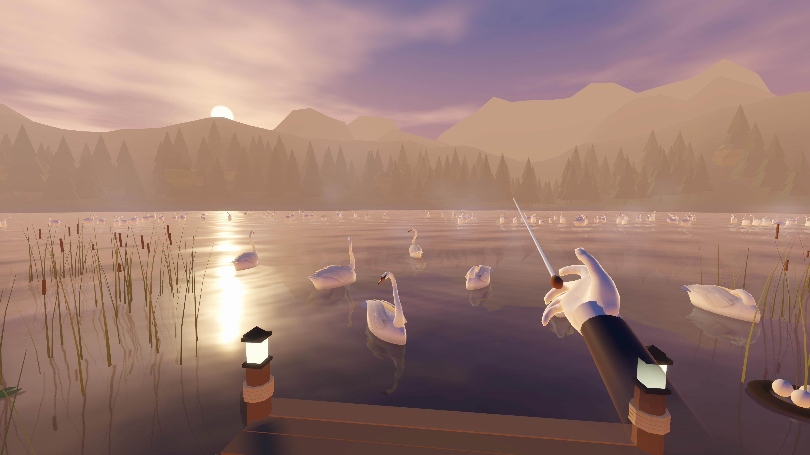

# Pico Swan Lake: The Conductor's Program

**An Agile Lens production.** Stand on a dock at the edge of a lake and conduct. A 24 minute program, a tuning and eight movements, runs
from before dawn to a fireworks finale, played by real recordings, and a flock of swans answers your hand. Each movement has its own hour,
its own weather and choreography, and its own thing your baton does.

Built for PICO headsets with Godot 4.7.2 and OpenXR. Works with controllers, bare hands, or a mouse and keyboard on the desktop.
This is an uplift of [Swan Lake XR](https://github.com/AgileLens/swan-lake-xr), which it keeps the conducting, ripples, gathering,
Cygnus stars and fireworks from. See [RECEIPT.md](RECEIPT.md) for what has and hasn't been verified, and read it before quoting anything here.

The launch now opens on a rounded program card with **Start**, **Instructions**, and a persisted
**Continue** movement checkpoint, accompanied by an original code-generated lake nocturne. The
settings arc includes five Mobile-renderer-safe visual styles, music volume/mute, and an independent
mesh-hand toggle. PICO real-hand camera compositing is explicitly labeled unavailable; changing
either visual setting never disables tracked hand/controller input. Controller actions use short
event haptics, not continuous vibration.

### Geometry integrity

The procedural geometry audit fixed the rainbow's reversed dock-facing winding and the environment
generator's inverted broadleaf crown caps. The tracked `env.glb` was repaired too: all 39 crowns
have outward top/bottom caps and all 298 zero-thickness reed blades carry explicit front and back
triangles. Solid scenery and foliage now use back-face culling; the old global two-sided environment
material is gone. `python3 tools/geometry_check.py` decodes the shipped GLB and checks those faces,
mirrored feather reversal and negative-determinant runtime scales without launching Godot.



## The Program

| | Movement | Music | Staging | Your baton |
|---|---|---|---|---|
| | Tuning | Swan Lake theme, synthesized harp and oboe | Before dawn, mist, the flock asleep | Raise it |
| I | Dawn | Grieg, Morning Mood | Sunrise, mist burning off | Lifts the sun, wakes swans one by one |
| II | Regatta | Handel, Alla Hornpipe | Bright morning, a breeze | Steers a line of swans across the lake |
| III | The Storm | Beethoven, Symphony 6, fourth movement | Black cloud, rain | Strike down on the crashes to call lightning |
| IV | After the Rain | Beethoven, Symphony 6, fifth movement | Clearing sun | Sweep to paint the rainbow |
| V | The Swan | Saint-Saëns, Le Cygne, 1925 recording | Golden hour into dusk | Long slow lines: she follows you, then the pair's necks form a heart |
| VI | Moonrise | Smetana, Moonlight from Vltava | Night, aurora, fireflies | Light the stars of Cygnus |
| VII | Scène | Tchaikovsky, Swan Lake | Moonlight, falling snow | Gather the flock into the moonbeam |
| VIII | Finale | Tchaikovsky, 1812 Overture, close | Clear night | Every downbeat launches a firework |

The program never waits for you and never scolds you. Off-beat gestures cost nothing, and nobody fails. If you do nothing at all,
it plays through to the end and the flock still takes a bow. The better you conduct, the more they give back: a nod on the beat, then
wings raised, a corps that rises, feathers falling, and a bigger barrage at the curtain. After that, stay on the lake as long as you like, or
call an encore.

Every recording's rights basis, including the ones rejected and why, is in [CREDITS.md](CREDITS.md).

## Controls

| Input | Action |
|---|---|
| Your hand, moving | Conducting. A downstroke on the beat counts, whichever input you use |
| Right trigger or right pinch | Downbeat and ripple. Also taps stars, the nest and the stand's knob |
| Left trigger or left pinch | Launch a firework where you point |
| Either grip, or both hands pinched | Gather the flock into the moonbeam |
| Right B, or the stand's knob twice | Next movement |
| Right A, left X | Change mood, change weather (after the program, or to experiment) |
| Left Y | Settings orbs (swan style, crowd size, reflections, shadows, baton pose, FPS HUD) |

Desktop: move the mouse to conduct, left click for a downbeat, right drag to look, ENTER for the next movement,
`G` gather, `K` firework, `SPACE` ripple, `W` weather, `M` settings.

## Quickstart

```bash
/Users/alex/GH/vibe-lab/picoswanlake/build.sh                    # debug APK at out/picoswanlake.apk
/Users/alex/GH/vibe-lab/picoswanlake/tools/test.sh               # logic checks, then the program played three ways
/opt/homebrew/bin/godot --xr-mode off --path /Users/alex/GH/vibe-lab/picoswanlake/project   # desktop preview
/opt/homebrew/bin/godot --xr-mode off --path /Users/alex/GH/vibe-lab/picoswanlake/project --resolution 640x360 -- --stills   # stills/ at 3840x2160
```

To regenerate assets (needs Blender 4.2, ffmpeg and a Python with numpy):

```bash
/Applications/Blender.app/Contents/MacOS/Blender --background --factory-startup --python /Users/alex/GH/vibe-lab/picoswanlake/assets_src/make_swan_hero.py
/Applications/Blender.app/Contents/MacOS/Blender --background --factory-startup --python /Users/alex/GH/vibe-lab/picoswanlake/assets_src/make_env.py
python3 /Users/alex/GH/vibe-lab/picoswanlake/tools/fetch_recordings.py
python3 /Users/alex/GH/vibe-lab/picoswanlake/assets_src/make_prelude.py
python3 /Users/alex/GH/vibe-lab/picoswanlake/tools/make_program_audio.py
```

## Things to Try

Audio safety regression: `godot --headless --xr-mode off --path project --script res://tests/audio_loop_bounds.gd` checks the live looping WAV streams against their actual PCM frame counts. Inclusive endpoints stay inside the final frame; headset audio longevity remains a device test.

1. **Just watch.** Put the controllers down for the whole Dawn movement. The flock wakes by itself, and the sun comes up anyway.
2. **In Dawn, hold your baton above your eyes.** Swans wake sooner, and the sun lifts with your hand.
3. **In The Storm, strike straight down on a crash.** The bolt lands where you're pointing.
4. **In After the Rain, sweep slowly from far left to far right.** The rainbow fills in behind your hand, and the harp follows.
5. **In the Finale, beat time hard.** Every downbeat launches from where you aim. Hold on for the cannons at the end, and watch the flock at the curtain.

## Credits

Music, source and rights: [CREDITS.md](CREDITS.md). Engine: Godot (MIT). XR loaders: godot_openxr_vendors (MIT). Hand mesh:
`godotengine/godot-demo-projects` (MIT). Everything else is procedural: © Agile Lens, released under the [MIT License](LICENSE).

Built by **Agile Lens**: real-time immersive design, NYC.
